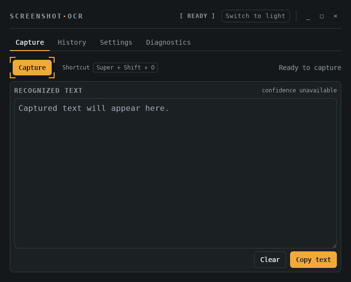

# Screenshot OCR

[](https://github.com/ekkus93/screenshot-ocr/actions/workflows/ci.yml)

Screenshot OCR is a privacy-first desktop utility for selecting visible screen text, recognizing it locally with Tesseract, and copying it to the clipboard. Linux is the existing release target; an experimental Windows x86-64 port is under qualification. It is optimized for terminal output, source code, and developer punctuation.



> **Status:** pre-release. Automated development is active; the mandatory Ubuntu 22.04/24.04 Wayland/X11 validation matrix is not yet complete.

## Initial platform scope

- Ubuntu 22.04 LTS, GNOME Wayland and X11
- Ubuntu 24.04 LTS, GNOME Wayland and X11
- English OCR with Tesseract 5
- GNOME screenshot helper compatibility backend
- `.deb` release package built on Ubuntu 22.04

Other distributions and desktop environments are unverified.

## Installing the latest tagged release

Each tag pushed to `master` (`vX.Y.Z`) is built by CI and published as a [GitHub release](https://github.com/ekkus93/screenshot-ocr/releases/latest) with the `.deb` package and its `sha256sum` attached.

With the [GitHub CLI](https://cli.github.com/):

```bash
gh release download --repo ekkus93/screenshot-ocr --pattern '*.deb' --pattern '*.sha256'
sha256sum ./*.deb   # compare against the hash in package.sha256
sudo dpkg -i ./*.deb
sudo apt-get install -f
```

(GitHub renames release assets by replacing spaces with dots, so the filename in `package.sha256` won't match the downloaded `.deb` exactly — compare the hash values, not `sha256sum --check`.)

Without `gh`, open the [latest release page](https://github.com/ekkus93/screenshot-ocr/releases/latest), download the `.deb` asset, then run the same `dpkg -i` / `apt-get install -f` pair (see [Installing a locally built package](#installing-a-locally-built-package) below for what each step does and how to uninstall).

Releases only exist starting with the first tag pushed after this packaging step was added; earlier tags have no release assets.

## Windows x86-64 development candidate (not released)

The `ralph/windows-support` branch builds a native Windows 10/11 candidate with an application-owned Win32 region selector, a shared Rust OCR pipeline, and an NSIS packaging smoke test. **A passing hosted Windows build does not establish that selection, mixed-DPI monitors, shortcuts, clipboard, installation, or offline OCR work on a real desktop.** Windows 10 22H2 and Windows 11 x86-64 are intended test targets, not yet verified release platforms.

The Windows shortcut is `Ctrl+Shift+O` when global registration succeeds. The tray exposes Capture text, Cancel capture, Show Screenshot OCR, and Quit. Settings migrated from Linux may contain GNOME or portal capture preferences; Windows uses its native backend instead. The application reports shortcut registration failures without preventing manual capture.

The Windows NSIS smoke installer stages checksum-verified Tesseract 5.4.0.20240606 and English trained data in an app-owned `resources/ocr/` directory. It does not search PATH or require a separate Tesseract installation at application runtime. OCR itself is local and requires no network, but **offline installation on a clean Windows machine has not been demonstrated**; WebView2 provisioning and native dependency licenses remain acceptance gates.

The development NSIS configuration embeds the WebView2 **offline installer**, not
Tauri's default download-at-install bootstrapper. This adds roughly 127 MB to
the setup payload but is intended to permit a disconnected installation even
on machines without the WebView2 runtime. Building the installer can still
require network access. **A clean disconnected install has not been tested**;
the runtime prerequisite, installer behavior, and native licenses must be
qualified on physical Windows hardware before release.

### Windows uninstall and settings retention policy

The intended NSIS uninstall policy is to remove installed application binaries,
bundled OCR resources, and installer-owned shortcuts, while **retaining
per-user settings by default**. Settings are stored through Tauri's
`app_config_dir()` outside the installed application directory; they are not
OCR history and must not be copied into installer logs. Reinstalling or
upgrading should reuse valid settings and recover safely from invalid settings.
To erase settings, the user must separately remove the application's own
configuration directory after exiting the application; do not delete the
entire Windows roaming-profile directory. **This is a policy, not verified
NSIS behavior**: uninstall/reinstall/upgrade and user-data retention require
physical Windows 10/11 acceptance before release.

The candidate installer is intentionally **not published**. Transitive DLL/license review, installer integrity checks, physical Windows 10/11 acceptance, and an explicit final integration decision are required first. No code signing is claimed. Do not treat the Linux release downloads as Windows installers.

For the implementation plan and remaining checks, see the [Windows portability TODO](docs/SCREENSHOT_OCR_WINDOWS_PORTABILITY_TODO_2026-10-09.md), [Windows specification](docs/SCREENSHOT_OCR_WINDOWS_PORTABILITY_SPEC_2026-10-09.md), and [runtime provenance ADR](docs/adr/0005-windows-tesseract-provenance.md).

## Architecture

- React, TypeScript, Vite, and Tailwind CSS frontend
- Tauri 2 desktop shell
- Rust application core for capture, image processing, OCR, settings, diagnostics, clipboard policy, and privacy-sensitive behavior
- Local-only OCR; no capture or recognized text is sent over the network

See:

- [v0.1 specification](docs/SCREENSHOT_OCR_V0_1_SPEC.md)
- [implementation TODO](docs/SCREENSHOT_OCR_V0_1_TODO.md)
- [architecture](docs/ARCHITECTURE.md)
- [privacy](docs/PRIVACY.md)
- [threat model](docs/THREAT_MODEL.md)
- [CI status bridge](docs/CI_STATUS_BRIDGE.md)
- [synthetic OCR fixtures](docs/OCR_SYNTHETIC_FIXTURES.md)

## Development prerequisites

Ubuntu 22.04 build packages:

```bash
sudo apt-get update
sudo apt-get install --yes \
  build-essential curl file libayatana-appindicator3-dev librsvg2-dev \
  libssl-dev libwebkit2gtk-4.1-dev libxdo-dev pkg-config wget
```

Runtime packages for the compatibility path:

```bash
sudo apt-get install --yes gnome-screenshot tesseract-ocr tesseract-ocr-eng
```

The project pins Node and Rust versions (`.node-version`, `src-tauri/rust-toolchain.toml`). Run `scripts/check-dev-tools.sh` to inspect prerequisites without modifying the host.

## Running it in development

```bash
npm ci
npm run tauri dev
```

This starts the Vite dev server and launches the Tauri window against it, with hot reload on frontend changes. Rust changes require a restart.

## Validation

```bash
npm ci
npm run validate
cargo fmt --manifest-path src-tauri/Cargo.toml --all -- --check
cargo clippy --manifest-path src-tauri/Cargo.toml --workspace --all-targets --all-features --locked -- -D warnings
cargo test --manifest-path src-tauri/Cargo.toml --workspace --all-features --locked
npm run tauri build
```

Hosted CI on Ubuntu 22.04 is authoritative for compilation and linting. Physical desktop validation remains a separate release gate.

`npm run tauri build` produces `src-tauri/target/release/bundle/deb/Screenshot OCR_<version>_amd64.deb`. A separate Playwright suite (`npm run test:layout`) checks that the Capture/Settings/Diagnostics tabs never require scrolling at the app's window size; it runs in CI but is not part of `npm run validate` since it needs a browser install step.

## Installing a locally built package

```bash
sudo dpkg -i "./src-tauri/target/release/bundle/deb/Screenshot OCR_0.1.0_amd64.deb"
sudo apt-get install -f
```

`dpkg -i` installs the local file directly. The follow-up `apt-get install -f` resolves any missing runtime dependencies (`gnome-screenshot`, `tesseract-ocr`) if they aren't already on the system; it's a no-op otherwise. (`sudo apt install ./path/to.deb` also works, but if your home directory isn't world-readable — `750` is Ubuntu's default — apt prints a harmless `pkgAcquire::Run (13: Permission denied)` sandboxing notice for local files under it; `dpkg -i` avoids that entirely since it never runs apt's sandboxed-download step.)

This installs the binary, the `.desktop` entry, and the app icon (`/usr/share/icons/hicolor/*/apps/screenshot-ocr.png`) — the desktop icon and taskbar entry only appear after installing this way, not when running the binary directly out of `target/release/`. To remove it:

```bash
sudo apt remove screenshot-ocr
```

## Shortcut, tray, and startup capture

The documented default shortcut is `Super+Shift+O`.

On GNOME Wayland, create a custom keyboard shortcut that runs:

```text
screenshot-ocr capture
```

The application does not modify GNOME settings automatically.

On Linux X11, the app attempts direct registration of `Super+Shift+O` and reports the registration result in diagnostics. On Wayland, diagnostics tell the user to use the GNOME custom shortcut path instead.

The binary recognizes only these exact first arguments:

```text
capture
cancel
toggle
show
quit
```

Unknown second-instance invocations only show the main window. They do not start capture implicitly.

The tray menu currently exposes only implemented actions:

```text
Capture text
Cancel capture
Show Screenshot OCR
Quit
```

There is no Settings tray action yet. Start-at-login, close-to-tray, and notification-after-copy are reserved pre-release settings and are not active behavior in this build.

`quit` cancels an active capture before exiting. The app does not currently keep running after the window is closed as a tray-only background utility.

## Fixture policy

Automated OCR cleanup tests use synthetic text fixtures only. Do not commit private screenshots, real OCR output, clipboard text, temporary paths, portal result URIs, or helper stdout/stderr from a real machine.

See [synthetic OCR fixtures](docs/OCR_SYNTHETIC_FIXTURES.md).

## License

MIT. See [LICENSE](LICENSE).
